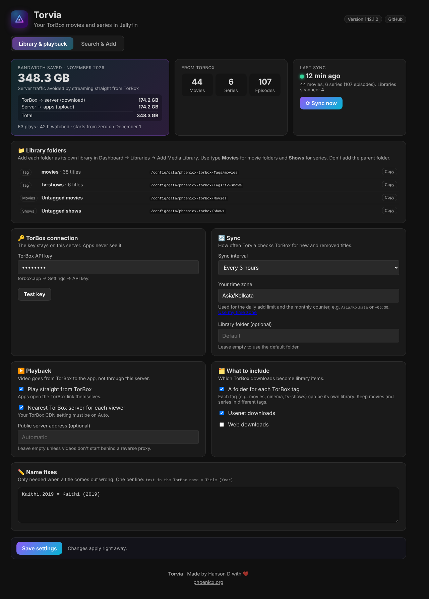
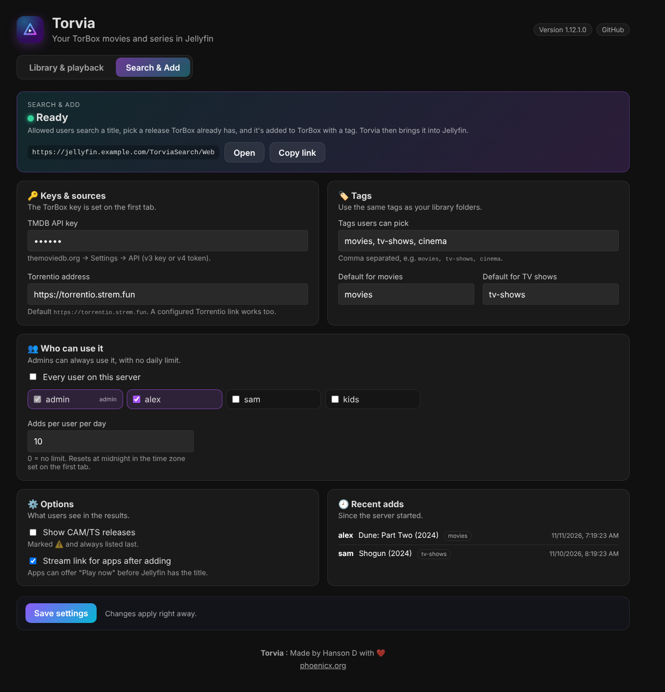

<p align="center"></p>

<h1 align="center">Torvia</h1>
<p align="center"><b>Straight from TorBox to Jellyfin.</b><br>
A Jellyfin plugin that turns your TorBox movies and series into real Jellyfin libraries —<br>
and streams them <b>directly from TorBox to your Jellyfin apps</b>, with no load on your server.</p>

<p align="center">
  <a href="https://github.com/hansonds/Torvia-Jellyfin/releases/latest"></a>
  
  
</p>

---

## ✨ Why Torvia

Normally, to watch your TorBox downloads in Jellyfin, the server has to **download the video and
pass it on** to your app (for example with an rclone mount). Every viewer then uses your server's
bandwidth, and a few 4K streams at once can make everything buffer.

**Torvia skips the middle step.** Jellyfin keeps the library, the posters and everyone's watch
history — but the video itself goes **straight from TorBox to the app**:

```
          Library, posters, watch history
 Your app  ◄──────────────────────────────►  Your Jellyfin server   (tiny traffic)
    ▲
    │  The movie itself
    └──────────────────────────────────────  TorBox  (no server in between)
```

When the app **direct plays** the file (plays it as it is, without converting), your server only
hands out the link. **No video passes through your server: no bandwidth, no CPU, no disk.**
That means faster starts, quicker seeking, smooth 4K, and many people can watch at the same time,
even on a small server.

---

## 📸 Screenshots

<p align="center"><b>Library &amp; playback</b><br>
</p>

<p align="center"><b>Search &amp; Add</b><br>
</p>

<p align="center"><sub>Shown with sample data.</sub></p>

---

## 🚀 Features

### Library
- 🎬 **Movies and series as normal Jellyfin libraries** — posters, details, ratings,
  collections, search: everything Jellyfin normally does.
- 📥 **Your whole TorBox account** — torrents, usenet and web downloads (each can be turned off).
- 🔄 **Automatic sync** — at startup and on a schedule you choose (every 30 minutes up to once a
  day, or only manually). New downloads appear, deleted ones disappear. **Sync now** button too.
- 🏷️ **TorBox tags → separate libraries** — tag downloads on TorBox (e.g. `cinema`, `movies`,
  `tv-shows`) and each tag becomes its own folder, so it can be its own Jellyfin library.
  Upper / lower case doesn't matter.
- 🧹 **Clean names from messy releases** — removes site names (`www.Site.company - …`), quality
  tags and release junk; reads `S01E02`, `1x02`, season folders, years, and titles in any language
  (Tamil, Hindi, Chinese, …).
- 🛡️ **Clean titles stay clean** — many releases hide a site name inside the video file
  (`PSArips.com | Heart.of.the.Beast…`, `www.1TamilMV.style`) that Jellyfin may show instead of the
  movie's name. Torvia puts the clean title back and locks it, so it can't be overwritten again.
- ✏️ **Name fixes** — correct any title by hand: `text in the TorBox name = Title (Year)`.
- 🕰️ **"Recently added" stays honest** — when Torvia renames or moves a title's file (a corrected
  name, a second version, another tag), the title keeps its original date, so it doesn't jump to
  the top of *Recently added* again.
- 🔗 **Refresh link** — a private link that starts a sync from any browser without signing in;
  keep it as a bookmark on your phone.
- 📅 **TorBox plan at a glance** — the settings page shows your TorBox plan and when it expires
  (or renews), in yellow during the last 7 days.
- 🎞️ **Versions** — the same movie in 2160p and 1080p shows as one movie with a version choice.
- 💬 **Subtitles** — subtitles inside the video work as usual; separate subtitle files from the
  download (`.srt`, `.ass`, `.ssa`, `.vtt`, `.sub`, `.smi`) are added next to the movie with their
  language (`.en`, `.ta`, `.hi`, …, forced and SDH too) so they appear in every app.

### Playback
- ⚡ **Direct from TorBox** — the app streams from TorBox's servers, not through yours.
- 👥 **Watch history per user** — watched status, resume points and *Continue Watching* are kept
  on your Jellyfin server for every user, like any other movie.
- 🔑 **Fresh link every play** — TorBox links expire; Torvia gets a new one each time, so nothing
  ever goes stale.
- 📱 **Works with Jellyfin apps** — Jellyfin web and Jellyfin Media Player get the TorBox link
  directly; other apps (Android, Android TV, iPhone, Kodi, …) ask the server as usual and are
  instantly redirected to TorBox.
- ⬇️ **Downloads for offline viewing** — the *Download* button in apps gives the real video from
  TorBox.
- 🌍 **Nearest TorBox server for each viewer** — TorBox picks its server by who asks for the link.
  Torvia passes the viewer's own internet address along, so everyone streams from the TorBox
  server closest to *them* (e.g. Europe for a friend in Germany, India for you), not closest to
  your server. Works behind Cloudflare and reverse proxies; set TorBox's own CDN setting to *Auto*.
- 📊 **Bandwidth saved counter** — the plugin page shows the server traffic avoided this month,
  with the calculation: *TorBox → server* (download) **+** *server → apps* (upload) = total, plus
  plays and hours watched. Starts again from zero every month. Counts TorBox items played directly (estimate: time
  watched × the file's bitrate).
- 🛟 **Safe fallback** — if TorBox doesn't give a link at that moment, Jellyfin plays it the normal
  way instead of failing.
- 🎛️ **Convert when an app can't play the file** — if a browser or app can't play a file's format
  (HEVC or DTS in a browser, MKV in Firefox), Jellyfin can convert it instead of the app loading
  forever. Files the app can play still go straight from TorBox.
- 🩺 **Check playback** — one button tests every step (TorBox key, the server's own play link,
  TorBox giving a link, the server opening it) and says in plain words which one fails.

### 🔎 Torvia Search (Search & Add)
- 🔍 **Search any movie or TV show** — by name, TMDB number or link, IMDb id (`tt…`) or link.
- ⚡ **Only releases TorBox already has cached** — pick one (quality, size, HDR, audio shown) and
  it's added to your TorBox instantly, with the tag you choose (e.g. `movies`, `tv-shows`).
  Whole seasons or single episodes for series. CAM/TS releases marked ⚠️ and listed last (or hidden).
- 🔄 **Straight into Jellyfin** — Torvia syncs right after the add, so the title appears in the
  library within moments.
- 🌐 **Web page for your users** — `https://your-server/TorviaSearch/Web`, works in any browser:
  - signs in with the Jellyfin account (or reuses the Jellyfin sign-in already in that browser);
  - shows **who is signed in** (and admin), how many adds are left today, and a **Sign out** link
    (signing out here doesn't sign you out of the Jellyfin app);
  - **My adds** (each user's own list, removable) / **All adds** for admins.
- 🔗 **Add your own link** — paste a magnet link or choose a .torrent file, pick which movie or
  show it is (TMDB search) and a tag. If TorBox has it cached it is ready at once; if not, TorBox
  downloads it and it appears in Jellyfin by itself when the download is finished. The list of
  adds shows the download progress. Can be turned off for non-admin users.
- 👥 **You decide who can use it** — every user, or only the users you tick; admins always can.
  **Daily limit** per user (admins unlimited).
- 🌐 **Two release sources at once** — besides the Torrentio address you can set a second
  Torrentio-style address (for example one set up for Malayalam / Tamil / other sites). Both are
  searched together and the results joined; if one is down, the other still answers.
- 📱 **Apps can use it too** — e.g. PHOENIXA's *Search & Add* button. API: [SEARCH-API.md](SEARCH-API.md).
- ⚙️ **Own settings tab** — *Search & Add* tab on the plugin page: TMDB API key, Torrentio addresses,
  users, daily limit, tags, options. The **TorBox key is shared** with the Torvia tab, and the web
  page link uses the **Public server address** from the Torvia tab when it's set.
- 🌐 **Torrentio note** — releases are looked up on Torrentio, which blocks many cloud / VPS
  servers. If searches fail with "Torrentio refused this server", run the server's traffic through
  a proxy (e.g. Cloudflare WARP) or use a self-hosted Torrentio address.
- ♻️ **Moving from the old separate "Torvia Search" plugin?** Its settings are copied over
  automatically on first start. Install Torvia, restart, then uninstall the old plugin.

### 🔔 Push notifications & messages (PHOENIXA)
- 📲 **"New on PHOENIXA" on phones** — the moment a new movie, series or episode appears in
  Jellyfin, each user gets one notification with what's new, only for titles they're allowed to see.
- ✉️ **Your own messages** — send a message to everyone or to chosen users from the settings page
  ("Server restart tonight at 11"). Phones get it as a notification; TVs show it the next time
  PHOENIXA checks.
- 🆓 **Free, and private to your server** — uses your own free Firebase project; nothing goes
  through anyone else. Full details: [Push notifications](#-push-notifications-phoenixa).

### Safe and private
- 🔒 **Your TorBox API key never leaves the server.** Apps only get short-lived TorBox links.
- ✍️ **Signed play links** — nobody can guess a link to your files.
- 🛡️ **Outage protection** — if TorBox is down or answers with an empty list, your library is
  kept as it is. A big clean-up on TorBox is only applied when it's still the same 6 hours later.
- 🚦 **Gentle on TorBox** — link requests are limited and reused for a short time, so even big
  library scans don't flood TorBox.
- 🗂️ **Your other libraries are untouched** — local, OneDrive, NAS, WebDAV movies play exactly as
  before.

---

## 📦 Installation

**You need:** Jellyfin **12.x** and a **TorBox** account with its API key. For Torvia Search, also a
free **TMDB API key**.

### 1. Add the repository
Jellyfin **Dashboard → Plugins → Repositories → +**

| Field | Value |
|---|---|
| Name | `Torvia` |
| URL | `https://raw.githubusercontent.com/hansonds/Torvia-Jellyfin/gh-pages/manifest.json` |

### 2. Install
**Plugins → Catalog → Torvia → Install**, then **restart Jellyfin**.

### 3. Set it up
**Dashboard → Torvia**
1. Paste your **TorBox API key** (torbox.app → Settings → API key) and click **Save**.
2. Click **Test API key** — it should say *Connected as …*.
3. Click **Sync now**.

### 4. Add the libraries
Reopen the Torvia page — it shows the folders to add. In
**Dashboard → Libraries → Add Media Library**:

| Library type | Folder |
|---|---|
| **Movies** | the *Movies* folder (e.g. `/config/data/phoenicx-torbox/Movies`) |
| **Shows** | the *Shows* folder (e.g. `/config/data/phoenicx-torbox/Shows`) |
| Movies **or** Shows | each **tag folder** listed (e.g. `…/Tags/cinema`) — match the type to what you tagged |

That's it. Jellyfin scans the libraries and your TorBox movies appear with posters.

> **Docker:** the folders are inside Jellyfin's own `/config` folder, so nothing in your Docker
> setup has to change.

### 5. Turn on Torvia Search (optional)
For **Search & Add** (search any movie or show and add it to TorBox):
1. Get a free **TMDB API key**: create an account at [themoviedb.org](https://www.themoviedb.org),
   then **Settings → API** → request a key. The *API Key* (v3) or the *API Read Access Token* (v4)
   both work.
2. **Dashboard → Torvia → Torvia Search** tab → paste it into **TMDB API key**.
3. Choose **who can use it** (every user, or tick users — admins always can), the **daily limit**,
   and the **tags** to offer (use the same tags as your Torvia tag folders, e.g. `movies,tv-shows`).
4. Click **Save**. The status box should say **✅ Ready** and shows the web page link
   (`https://your-server/TorviaSearch/Web`) to give to your users.

The TorBox key is taken from the Torvia tab — no need to enter it again.

### Updating
New versions install themselves overnight (Jellyfin's *Update Plugins* task) and take effect after
a restart. To update now: **Catalog → Torvia → pick the newest version → Install → restart**.

---

## ⚙️ Settings

| Setting | What it does | Default |
|---|---|---|
| **TorBox API key** | The only required setting. | — |
| Public server address | Optional. Leave empty: each app gets the address it connected with. Only fill it in if TorBox videos don't start behind your reverse proxy. | empty (automatic) |
| Your time zone | For the Search daily limit and the monthly bandwidth counter (e.g. `Asia/Kolkata`). | the server's clock |
| Library folder | Where the library files go. | Jellyfin's data folder |
| Sync interval | How often TorBox is checked. | every 3 hours |
| Copy refresh link | A private link that starts a sync when opened in any browser, without signing in. Handy as a phone bookmark. | - |
| Play straight from TorBox | Apps stream from TorBox directly. | on |
| Convert when an app can't play the file | If Jellyfin finds the app can't play a file's format, it converts it (through your server) instead of the app loading forever. Off = always send the file straight from TorBox. | on for new installs |
| Check playback | Button that tests each playback step with one title and says which one fails. | - |
| Nearest TorBox server for each viewer | Each viewer gets the TorBox server closest to them. | on |
| A folder for each TorBox tag | One library per tag. | on |
| Include usenet / web downloads | Also list those downloads. | on |
| Name fixes | Fix titles that come out wrong, one per line: `Kaithi.2019 = Kaithi (2019)` | empty |

The page also shows the **bandwidth saved** counter and the last sync result: movies, series,
episodes, subtitles, tag folders, libraries scanned, titles fixed, and any file names that couldn't
be read.

### Search & Add tab

| Setting | What it does | Default |
|---|---|---|
| **TMDB API key** | Needed for searching (themoviedb.org → Settings → API; v3 key or v4 token). | — |
| Torrentio address | Where cached releases are looked up; a configured Torrentio link works too. | `https://torrentio.strem.fun` |
| Second address (optional) | A second Torrentio-style address, searched at the same time; results are joined. For example a Torrentio link set up for other languages or sites. | empty |
| Every user on this server | Let all users use Search & Add. | off |
| User list | Tick the users who may use it (admins always can). | — |
| Adds per user per day | Daily limit for non-admins (0 = no limit). | 10 |
| Tags / default movie tag / default TV tag | Tags users can pick when adding — use the same tags as your Torvia tag folders. | `movies,tv-shows` |
| Give a direct stream link after adding | For apps using the API (e.g. PHOENIXA): they can offer *Play now* before Jellyfin has the title. The web page doesn't show it. | on |
| Show CAM/TS releases | Marked ⚠️ and listed last. | on |
| Users can add their own magnet link or torrent file | The "Add a link" tab. Uncached links make TorBox download them (uses a download slot). Admins always can. | on |

The tab also shows whether Search is ready, the web page link, the recent adds, and the PHOENIXA
app with its download links.

### Push notifications tab

| Setting | What it does | Default |
|---|---|---|
| Send push notifications to PHOENIXA | Switches notifications to phones on or off. | off |
| google-services.json | The Firebase settings of the PHOENIXA app (from your own Firebase project). Not secret. | — |
| Service account key | Lets this server send through Firebase. Kept secret on the server; after saving only its email is shown, with a **Replace** button. | — |
| Send test to my devices | Sends a test notification to your own phones. | - |
| Send a message | Title, message (up to 500 characters), **Everyone** or chosen users, **Send message**. The last 10 sent messages are listed with **Delete**. | - |

The tab also shows how many devices are registered (and how many are yours), the setup steps,
and the PHOENIXA app with its download links.

### Start a sync from a script or bot
Create an API key in **Dashboard → API Keys**, then:
```bash
curl -X POST "https://your-jellyfin-server/PhoenicxTorBox/Sync" -H 'Authorization: MediaBrowser Token="YOUR_API_KEY"'
curl "https://your-jellyfin-server/PhoenicxTorBox/Status" -H 'Authorization: MediaBrowser Token="YOUR_API_KEY"'
```

---

## 🔔 Push notifications (PHOENIXA)

Torvia can tell **PHOENIXA** users the moment something new arrives: a "New on PHOENIXA"
notification on their phone, like a chat message. You can also send your own messages to your
users. It uses Firebase Cloud Messaging, which is free.

Get PHOENIXA: [Google Play](https://play.google.com/store/apps/details?id=org.phoenicx.nova) ·
[APK from GitHub](https://github.com/hansonds/PHOENIXA/releases/latest/download/PHOENIXA.apk)

### What sends a notification

Once push is on and set up, it's automatic; there's nothing to press.

- **Every new movie, series or episode in Jellyfin** — not only TorBox titles: local, OneDrive or
  NAS libraries too, and titles added with Search & Add.
- **Each user only hears about titles they can see** (their library access and parental rating).
- **Several at once = one notification.** Torvia waits until nothing new has arrived for a minute
  (at most 5 minutes), then sends each user one notification with up to 10 titles, newest first. A
  new season gives one notification, not ten; when a whole series is new, its episodes aren't
  listed separately.

**When it stays quiet:**

- **Big scans** — more than 50 new items at once (for example adding a whole new library) sends
  nothing, so nobody's phone gets flooded.
- **Renamed or moved files** — Torvia keeps their old date, so they don't count as new.
- **Older titles** — anything whose date added is more than 2 days old.
- **Disabled users**, trailers, extras, and episodes that aren't there yet (missing episodes).

**Where it shows:**

- **Phones** (and Android TVs with Google Play services) get a real notification.
- **Fire TV** has no Google Play services, so it can't get push notifications. New titles show up
  in PHOENIXA's normal *Recently added* lists there, and your own messages still reach it (see below).

### Your own messages

The **Send a message** box on the Push notifications tab:

1. Write a title (optional; "PHOENIXA" when empty) and a message (up to 500 characters).
2. Choose **Everyone** (every enabled user) or untick it and tick the users you want. Each user
   shows how many phones they have registered, or "TV only".
3. Press **Send message**.

- **Phones** get it straight away as a notification (when push is set up).
- **Every message is also saved on the server**, so PHOENIXA on TVs (and phones without push)
  shows it the next time it checks, for up to 7 days. This works even if you never set up Firebase.
- The **last 10 sent messages** are listed with the time, the title and who it went to, each with a
  **Delete** button. A deleted message is no longer given to devices that haven't shown it yet.
- Messages are kept for 30 days (at most 50), then removed by themselves.

### Setup (once, about 10 minutes, free)

You only need a Google account. No coding: ignore any code Firebase shows you.

1. **Create a Firebase project.** Open [console.firebase.google.com](https://console.firebase.google.com),
   press **Create a project** (or **Add project**). Any name works, e.g. `PHOENIXA`. When it asks
   about **Google Analytics**, switch it **off** (not needed), press **Create project** and wait
   until it's ready.
2. **Add the Android app.** On the project page press the **Android** icon (or **Add app →
   Android**). In *Android package name* type exactly **`org.phoenicx.nova`** (all small letters,
   two dots, no quotes). The nickname can be anything; leave SHA-1 empty. Press **Register app**.
3. **Download google-services.json.** The next screens show code for app developers: skip them with
   **Next** and finish with **Continue to console**.
4. **Download the service account key.** Click the ⚙️ gear next to *Project Overview* →
   **Project settings** → tab **Service accounts** → **Generate new private key** → **Generate key**.
   A second .json file downloads. Keep it private: it lets anyone send notifications from your project.
5. **Paste both files** into Torvia's **Push notifications** tab: open each file in Notepad
   (right-click → Open with → Notepad), press Ctrl+A, Ctrl+C, and paste it into the matching box.
6. **Switch it on.** Tick **Send push notifications to PHOENIXA** and press **Save settings**. The
   status at the top turns **On**. You can now delete the downloaded key file.
7. **Test it.** On your phone open PHOENIXA (close and reopen it if it was already open) and allow
   notifications when asked. Back in Torvia, **Yours** shows 1 or more; press **Send test to my devices**.

### Other servers

Every server owner who wants notifications makes **their own** free Firebase project with the same
steps (the package name is always `org.phoenicx.nova`). PHOENIXA asks the server it's signed in to
for that server's Firebase settings, so:

- each server sends with its own key, to its own users; nothing goes through anyone else;
- a server that isn't set up simply sends no notifications (PHOENIXA still works normally, and the
  owner's messages still reach TVs);
- a phone gets notifications from the server PHOENIXA is signed in to.

### Privacy and safety

- The **service account key stays on your server**, in its own file readable only by Jellyfin. It
  is never sent back to the settings page or to apps, and never written to the logs.
- Apps only get the public Firebase app settings (project id, app id, API key, sender id).
- Phones that sign out of Jellyfin are removed from the list automatically (checked daily and
  before every send), and so are phones Firebase no longer knows.
- Device tokens are never written to the logs; each send is logged as one line (user, number of
  titles, devices ok / failed).

### If notifications don't arrive

| What you see | What to do |
|---|---|
| Status says *Switched on, but not set up yet* | Paste both files and press **Save settings**. |
| Warning that the two files are from different projects | Both files must come from the same Firebase project. Replace one of them. |
| Test says *No device got it*, and **Yours** is 0 | Your phone hasn't registered. Update PHOENIXA, close and reopen it signed in as the same user, allow notifications, then reload the settings page. |
| **Yours** is 1 or more, but nothing arrives | Check *Dashboard → Logs* for lines starting with `Torvia push`; they say why Firebase refused. Also check the phone's notification settings for PHOENIXA and battery saving. |
| New titles don't notify | They may be older than 2 days, part of a scan of more than 50 items, or not visible to that user. Notifications arrive about a minute after the title shows up in Jellyfin. |
| Nothing on Fire TV | Expected: Fire TV can't receive push. Your own messages still appear there. |

### API for apps

All calls need a signed-in Jellyfin user.

| Call | Body / answer |
|---|---|
| `GET /TorviaPush/Config` | `{enabled, projectId, appId, apiKey, senderId}`, or `{enabled: false}` when off or not set up. Never the service account. |
| `POST /TorviaPush/Register` | `{token, deviceId, deviceName, platform, appVersion}` → 204. One entry per device; the same token under another device replaces it. |
| `POST /TorviaPush/Unregister` | `{deviceId}` → 204. |
| `POST /TorviaPush/Test` | Sends a test to the caller's devices → 204, or 404 when none got it. |
| `GET /TorviaPush/Messages` | The owner's messages for the caller from the last 7 days, newest first, at most 20: `{messages: [{id, title, body, sentAt}]}` (`sentAt` in UTC, e.g. `2026-11-22T11:00:00Z`). |

Push messages are **data-only** (the app builds the notification): `type` (`new_titles`,
`message` or `test`) and `userId` (32 hex letters). `message` adds `title` and `body`.
`new_titles` adds `items`, a JSON list (as a string) of up to 10 titles with `id`, `type`
(`Movie`, `Series`, `Episode`), `name`, `year`, and for episodes `seriesId`, `seriesName`,
`season`, `episode`. Android priority is high, kept for 24 hours if the phone is offline.

---

## 📱 Apps

| App | Direct from TorBox |
|---|---|
| Jellyfin web (browser), Jellyfin Media Player / Desktop | ✔ gets the TorBox link |
| Jellyfin Android, Android TV, Findroid, Wholphin | ✔ redirected to TorBox |
| iPhone / iPad: Streamyfin, Swiftfin, Infuse | ✔ redirected to TorBox |
| Kodi (JellyCon) | ✔ redirected to TorBox |

**Direct play is the key.** The video goes TorBox → app only when the app plays the file as it is.
If an app wants to convert it (format the device can't play, or a quality / bitrate limit set in
the app), that conversion has to happen on the server. Set the app's streaming quality to
**Maximum / Auto** for the best result.

**Check it yourself:** while a TorBox movie plays, the server's network traffic should barely move
(`docker stats` → *NET I/O*), or watch the browser's Network tab: the video comes from a TorBox
address (`…tb-cdn…`).

---

## ❓ FAQ

**Does deleting something on TorBox remove it from Jellyfin?**
Yes, at the next sync. Watch history is kept by Jellyfin, so if you add it again later it usually
comes back as watched.

**What if TorBox is down?**
Browsing still works (everything is stored in Jellyfin); TorBox movies play again once TorBox is
back. Your library is never emptied because of an outage.

**A movie shows a website name as its title — why?**
The release group wrote their site name into the video file's own title. Torvia fixes this
automatically for TorBox movies (clean title from the folder, locked). For other libraries, untick
*Prefer embedded titles over filenames* in the library settings and refresh its metadata.

**How many movies can it handle?**
No limit in the plugin — as many as your TorBox plan keeps. Each item is a ~100-byte file. The
first scan of a big library takes a while because Jellyfin reads every new title once.

**Can many people watch at once?**
Yes. Since the video comes from TorBox, your server isn't the bottleneck. TorBox allows using an
account from different places; very heavy use falls under TorBox's fair-use rules.

**Does Torvia update itself?**
Jellyfin's *Update Plugins* scheduled task (Dashboard → Scheduled Tasks) checks once a day and
installs new versions from your plugin repositories. A new version only takes effect after
Jellyfin restarts. To update right away: Dashboard → Plugins → Catalog → Torvia → install the
newest version → restart.

**Do I need PHOENIXA?**
No. Torvia works with every Jellyfin app. PHOENIXA adds Search & Add inside the app, push
notifications and your own messages on phones and TVs.

**Do other server owners use my Firebase project for notifications?**
No. Each server owner makes their own free project (see [Push notifications](#-push-notifications-phoenixa));
your key never leaves your server.

**What happens when Jellyfin updates?**
Small updates: nothing, it keeps working. A new major Jellyfin version may need a new Torvia
version — your libraries and watch history stay in the meantime.

---

## 🧰 Troubleshooting

Start with **Check playback** on the settings page (Playback card). It tests every step with one
of your titles and says which one fails. The cases below cover what it finds, and what it can't
see from the server.

### A title loads or buffers forever

| What you see | Why | What to do |
|---|---|---|
| Check playback is all green, and it happens in a **browser** | The browser can't play that file's format. Browsers handle H.264 video with AAC audio; most can't play HEVC/x265, DTS, TrueHD or E-AC3, and Firefox can't open MKV files at all. | Turn on **Convert when an app can't play the file** (Playback card), or play in an app that handles every format: Jellyfin Media Player / Jellyfin Desktop on a computer, or a TV or phone app. Or pick an x264 release with AAC audio. |
| Dashboard shows the session as **Transcoding** and it stutters | Jellyfin is converting the video on your server while pulling it from TorBox. A small server can't keep up, especially with 4K or HEVC. | Use an app that plays the file directly (see above), choose a smaller or x264 release, or turn on hardware acceleration in Jellyfin (Dashboard → Playback). |
| Check playback fails at **Server reaches its own play link** | Jellyfin isn't answering on its own local address. Usually *Bind to local network address* is set to one address only. | Dashboard → Networking: leave *Bind to local network address* empty (or add `127.0.0.1`), restart Jellyfin, then press **Sync now**. |
| Check playback fails at **TorBox gives a video link** | TorBox refused: the key is wrong, the plan ran out, or the download was removed from TorBox. | The message says which. Check the plan shown under the API key, then press **Sync now**. |
| Check playback fails at **Server opens the TorBox link** | The server can't reach TorBox's video servers (DNS filter, firewall, VPN or proxy on the server). | Allow the server to reach `torbox.app` and its video servers. |
| All green, and it only fails on **one device** | That device can't reach TorBox. The video comes straight from TorBox, not from your server. | Turn off the VPN, ad blocker or DNS filter (Pi-hole, AdGuard, NextDNS) on that device or allow TorBox, and try another network. |
| It fails only **away from home**, behind a reverse proxy | The app was given an address it can't open from outside. | Put the address you use to open Jellyfin (for example `https://jellyfin.example.com`) in **Public server address**, save, and press **Sync now**. |
| It plays, but stops after a long **pause** | The TorBox link ran out while paused. | Stop and press play again; it resumes where you were. |
| Slow or stuttering for a viewer far away | They get a TorBox server far from them. | Turn on **Nearest TorBox server for each viewer**, with the CDN setting on *Auto* in your TorBox account. |

To see what an app is doing, start the title and open **Dashboard** in another tab: the session
shows *Direct playing* (straight from TorBox) or *Transcoding* (converted on your server).

### A title I added doesn't show up in Jellyfin

- **Check the Last sync card.** It shows what was added and any error. Press **Sync now** if in doubt.
- **Add every folder as a library.** With *A folder for each TorBox tag* on, each tag has its own
  folder under *Library folders*, and a title only shows once that folder is a Jellyfin library
  (type **Movies** for films, **Shows** for series). Never add the parent folder.
- **Is it finished on TorBox?** Only finished downloads are listed. Your own magnet links that
  TorBox has to download first appear when the download is done.
- **Odd file name?** If the Library folders card says some names couldn't be read, add a line
  under **Name fixes**, e.g. `Kaithi.2019 = Kaithi (2019)`.
- **Usenet or web downloads** only show when their boxes are ticked under *What to include*.

### Search & Add finds nothing or gives an error

- **"Needs a TMDB key"**: add a free TMDB key on the Search & Add tab.
- **No releases found**: only releases TorBox already has cached are listed. Try another title
  or season, or use **Add a link** with your own magnet link.
- **Torrentio blocked**: some hosting providers are blocked by Torrentio. The error says so; set
  a different Torrentio address on the Search & Add tab.

### Still stuck?

Open an issue with: your Jellyfin and Torvia versions, how Jellyfin runs (Docker, Windows, NAS),
the app you play in, what **Check playback** shows, and any lines containing `Torvia` from the
Jellyfin log (Dashboard → Logs) from when you pressed play.

---

## 🛠️ How it works

For every movie and episode Torvia writes a tiny `.strm` file (a link instead of a video), e.g.
`Movies/Dune (2021)/Dune (2021).strm`, holding a signed link to your own server:
`https://your-jellyfin-server/PhoenicxTorBox/Play/t/123/4?sig=…`

Jellyfin treats these as normal library items. When an app presses play, Torvia asks TorBox for a
fresh download link and hands it to the app (or redirects the app's normal stream request to it),
so the app streams the file straight from TorBox.

---

<p align="center">
  <b>Torvia</b> : Made by Hanson D with ❤️<br>
  <a href="https://phoenicx.org">phoenicx.org</a>
</p>

<p align="center"><sub>Torvia is an independent project and is not affiliated with TorBox or Jellyfin.</sub></p>
